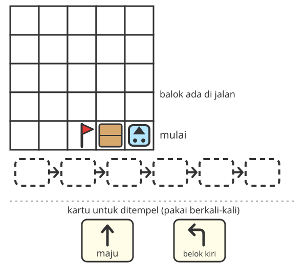

`[Gambar: kisi lima kali lima petak dilihat dari atas. Robot kecil berdiri di petak pojok kanan bawah menghadap ke atas, ditandai "mulai". Bendera merah ada di petak ketiga dari kiri pada baris paling bawah. Satu balok cokelat berdiri di petak keempat dari kiri pada baris paling bawah, tepat di antara robot dan bendera. Di bawah kisi ada enam kotak kosong bergaris putus-putus, dihubungkan tanda panah.]`

`[Gambar: di bagian bawah ada dua jenis kartu untuk digunting dan dipakai berkali-kali: kartu "maju" dengan panah lurus ke atas dan kartu "belok kiri" dengan panah melengkung ke kiri.]`

**Kata guru:** "Ada balok di jalan, robot tidak boleh menabraknya. Cari jalan lain ke bendera dengan jarimu. Lalu susun kartunya di enam kotak."

**Kotak jawab:** tempel kartu di enam kotak, kartu pertama di kotak pertama.

**Ceritakan:** `[Gambar: satu kotak kosong di bawah, dengan gambar kecil mulut yang sedang berbicara.]`

**Kata guru:** "Kasih tahu temanmu: robot lewat jalan yang mana, dan mengapa tidak lewat dekat balok?"

**Catatan cetak (untuk guru, tidak dicetak):** satu lembar per anak atau pasangan, kertas A4; siapkan sedikitnya empat kartu "maju" dan dua kartu "belok kiri" per lembar. Jawaban contoh untuk guru: maju, belok kiri, maju, maju, belok kiri, maju. Tanpa kolom nama, tanggal, atau penilaian.
