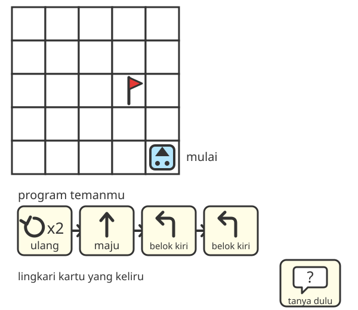

`[Gambar: kisi lima kali lima petak dilihat dari atas. Robot kecil berdiri di petak pojok kanan bawah menghadap ke atas, ditandai "mulai". Bendera merah ada di petak keempat dari kiri pada baris ketiga dari atas.]`

`[Gambar: di bawah kisi ada program empat kartu milik teman, tersusun dari kiri ke kanan dan dihubungkan tanda panah: "ulang x2", "maju", "belok kiri", "belok kiri". Di pojok kanan bawah ada satu kartu bergambar balon bicara dengan tanda tanya, bertuliskan "tanya dulu".]`

**Kata guru:** "Ini program milik temanmu. Robot belum sampai di bendera. Tunjuk kartu satu per satu dengan jarimu, lalu lingkari kartu yang keliru."

**Kotak jawab:** lingkari satu kartu yang keliru.

**Ceritakan:** `[Gambar: satu kotak kosong di bawah, dengan gambar kecil mulut yang sedang berbicara.]`

**Kata guru:** "Pegang kartu tanya dulu. Kasih tahu temanmu dengan sopan: kamu bertanya apa lebih dulu, dan kartu mana yang bisa diganti?"

**Catatan cetak (untuk guru, tidak dicetak):** satu lembar per anak atau pasangan, kertas A4; kartu "tanya dulu" boleh digunting dan dipakai di kegiatan kelompok. Jawaban contoh untuk guru: kartu keempat keliru; gantikan dengan "maju" agar susunan menjadi ulang x2, maju, belok kiri, maju. Tanpa kolom nama, tanggal, atau penilaian.
