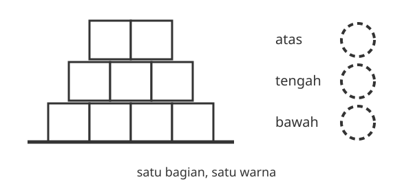

`[Gambar: menara balok dilihat dari depan, tiga tingkat bertumpuk: bagian atas dua balok, bagian tengah tiga balok, bagian bawah empat balok. Semua balok masih putih berbingkai garis tebal. Di sebelah kanan ada tiga lingkaran kosong bergaris putus-putus, berlabel "atas", "tengah", dan "bawah".]`

**Kata guru:** "Menara besar ini dibagi jadi tiga bagian. Beri satu warna untuk bagian atas, satu warna untuk bagian tengah, dan satu warna untuk bagian bawah. Lalu warnai lingkaran di sebelahnya dengan warna yang sama."

**Kotak jawab:** warnai tiga bagian menara dan tiga lingkaran, satu warna untuk satu bagian.

**Ceritakan:** `[Gambar: satu kotak kosong di bawah, dengan gambar kecil mulut yang sedang berbicara.]`

**Kata guru:** "Kasih tahu temanmu: bagian mana yang kamu kerjakan, dan bagian mana yang dikerjakan lebih dulu?"

**Catatan cetak (untuk guru, tidak dicetak):** satu lembar per anak atau pasangan, kertas A4; siapkan tiga krayon berbeda warna per anak. Jawaban contoh untuk guru: tiga bagian berbeda warna (atas, tengah, bawah); bagian bawah dikerjakan lebih dulu. Tanpa kolom nama, tanggal, atau penilaian.
