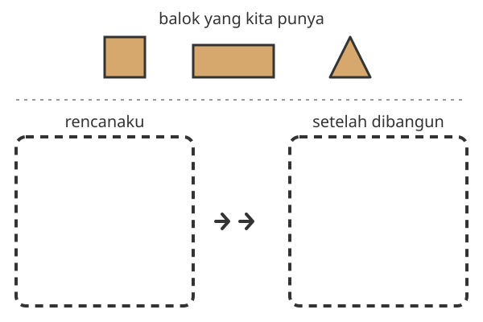

`[Gambar: di bagian atas ada tiga bentuk balok cokelat: satu persegi, satu persegi panjang, dan satu segitiga. Di bawahnya ada dua kotak besar bergaris putus-putus, dihubungkan dua tanda panah. Kotak kiri berjudul "rencanaku", kotak kanan berjudul "setelah dibangun".]`

**Kata guru:** "Gambar bangunanmu di kotak rencanaku. Lalu bangun dari balok yang sama. Setelah jadi, gambar bangunan yang kamu lihat di kotak setelah dibangun."

**Kotak jawab:** gambar di dua kotak: rencana lebih dulu, hasil bangunan sesudahnya.

**Ceritakan:** `[Gambar: satu kotak kosong di bawah, dengan gambar kecil mulut yang sedang berbicara.]`

**Kata guru:** "Kasih tahu temanmu: apa yang sama dari dua gambarmu, apa yang berbeda, dan apa yang kamu perbaiki?"

**Catatan cetak (untuk guru, tidak dicetak):** satu lembar per anak atau pasangan, kertas A4; siapkan krayon dan balok tiga bentuk. Tanpa jawaban tunggal: tiap anak membuat rencananya sendiri. Tanpa kolom nama, tanggal, atau penilaian.
