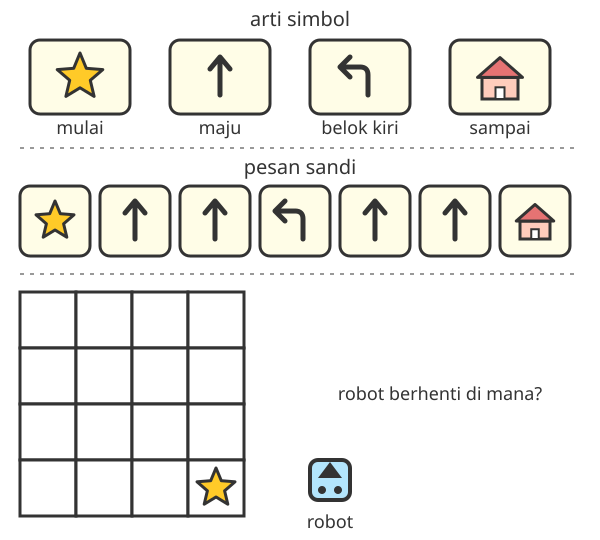

`[Gambar: di atas ada empat kartu arti simbol: bintang berarti "mulai", panah lurus ke atas berarti "maju", panah melengkung ke kiri berarti "belok kiri", dan rumah berarti "sampai". Di tengah ada pesan sandi tujuh kartu berderet: bintang, maju, maju, belok kiri, maju, maju, rumah. Di bawah ada kisi empat kali empat petak dilihat dari atas; bintang ada di petak pojok kanan bawah, dan robot kecil berdiri di sebelah kisi.]`

**Kata guru:** "Baca pesan sandi ini. Jalankan robot dari bintang sesuai kartunya. Gambar rumah di petak tempat robot berhenti."

**Kotak jawab:** gambar satu rumah di satu petak kisi.

**Ceritakan:** `[Gambar: satu kotak kosong di bawah, dengan gambar kecil mulut yang sedang berbicara.]`

**Kata guru:** "Kasih tahu temanmu: kartu mana yang pertama, kartu mana yang terakhir, dan apa artinya?"

**Catatan cetak (untuk guru, tidak dicetak):** satu lembar per anak atau pasangan, kertas A4; siapkan krayon. Jawaban contoh untuk guru: rumah di petak kedua dari kiri pada baris kedua dari atas (robot menghadap ke atas, dua petak ke atas, belok kiri, dua petak). Tanpa kolom nama, tanggal, atau penilaian.
