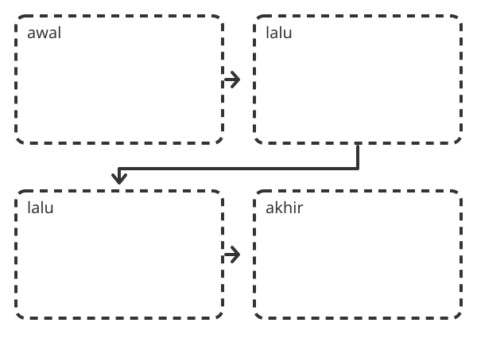

`[Gambar: empat kotak besar bergaris putus-putus dalam dua baris. Baris atas dari kiri ke kanan: kotak berlabel "awal" dan kotak berlabel "lalu", dihubungkan satu tanda panah. Baris bawah dari kiri ke kanan: kotak berlabel "lalu" dan kotak berlabel "akhir", dihubungkan satu tanda panah. Satu garis berpanah turun dari kotak kedua, berbelok ke kiri, dan menuju kotak ketiga.]`

**Kata guru:** "Gambar ceritamu di kotak-kotak ini, satu halaman satu gambar. Mulai dari awal, lalu, lalu, sampai akhir."

**Kotak jawab:** gambar tiga atau empat halaman cerita, dari kotak awal sampai kotak akhir.

**Ceritakan:** `[Gambar: satu kotak kosong di bawah, dengan gambar kecil mulut yang sedang berbicara.]`

**Kata guru:** "Kasih tahu temanmu ceritamu: apa yang terjadi di awal, lalu apa, dan apa di akhir?"

**Catatan cetak (untuk guru, tidak dicetak):** satu lembar per anak, kertas A4; siapkan krayon. Sesudah sesi, guru menggunting kotak dan menjilidnya berurutan. Tanpa jawaban tunggal: tiap anak membuat ceritanya sendiri. Tanpa kolom nama, tanggal, atau penilaian.
