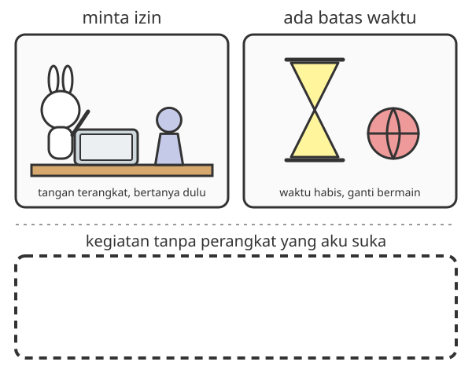

`[Gambar: dua gambar berdampingan. Kiri berjudul "minta izin": boneka kelinci putih mengangkat satu tangan di dekat sebuah tablet abu-abu di meja, dan seorang dewasa polos tanpa wajah berdiri di sebelahnya. Kanan berjudul "ada batas waktu": sebuah jam pasir kuning dan sebuah bola merah. Di bawahnya ada satu kotak kosong bergaris putus-putus berjudul "kegiatan tanpa perangkat yang aku suka".]`

**Kata guru:** "Ada dua aturan memakai perangkat. Tunjuk gambar pertama dan sebut aturannya. Tunjuk gambar kedua dan sebut aturannya. Lalu gambar satu kegiatan yang kamu suka tanpa perangkat."

**Kotak jawab:** gambar satu kegiatan favorit tanpa perangkat di kotak bawah.

**Ceritakan:** `[Gambar: satu kotak kosong di bawah, dengan gambar kecil mulut yang sedang berbicara.]`

**Kata guru:** "Kasih tahu temanmu: apa dua aturan memakai perangkat, dan apa yang kamu lakukan kalau waktunya habis?"

**Catatan cetak (untuk guru, tidak dicetak):** satu lembar per anak, kertas A4; siapkan krayon. Jawaban contoh untuk guru: aturan pertama "minta izin dulu", aturan kedua "ada batas waktu". Tanpa kolom nama, tanggal, atau penilaian.
