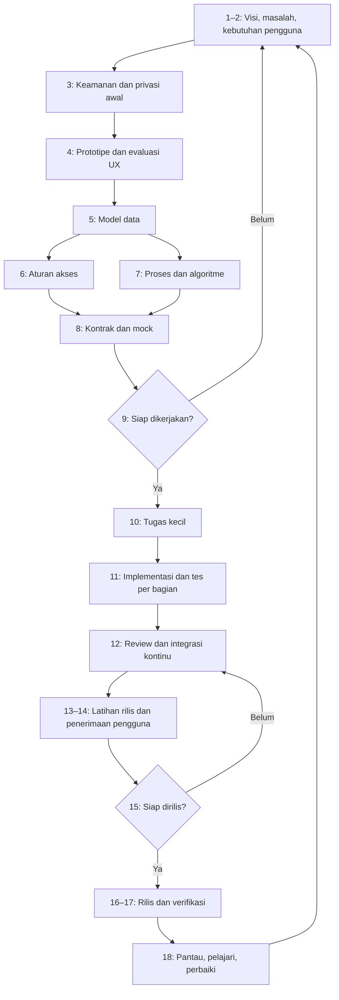
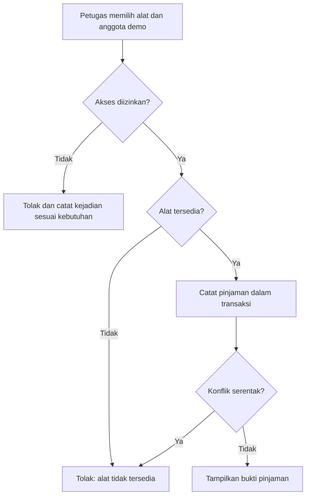
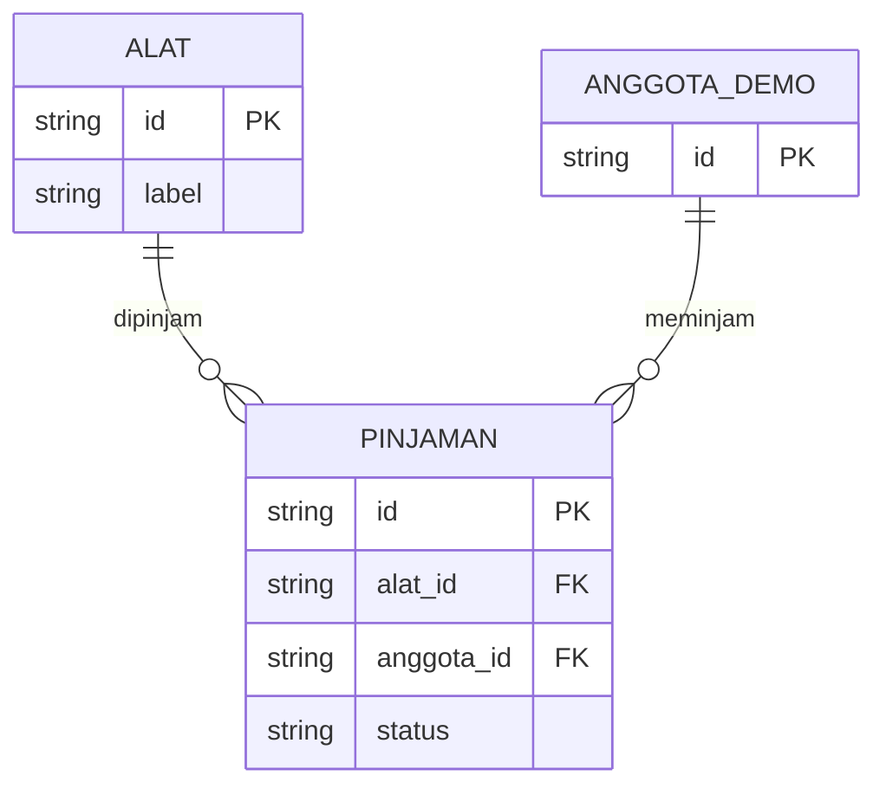

# AhliWeb Software Engineering Standard (AWSES) — Panduan Belajar Rekayasa Perangkat Lunak

- **Version:** v0.1.0
- **Last updated:** 2026-11-28
- **Status:** **DRAF — materi pengayaan publik, belum ditinjau sebagai modul atau silabus program.**
- **Penyusun:** Tim Riset AhliKoding.com — AhliWeb.com.
- **Lingkup:** pembelajaran umum, netral bahasa pemrograman, framework, cloud dan penyedia AI. Bukan standar nasional/internasional, sertifikasi, atau pernyataan kepatuhan. Tidak mengubah silabus yang disetujui.
- **Changelog:** v0.1.0: panduan konseptual, peta jenjang, contoh, latihan dan rubrik (issue #302).

## 1. Apa itu AWSES?

AWSES adalah kerangka belajar untuk memahami pengembangan perangkat lunak dari masalah nyata sampai pemeliharaan dan penghentian. Perangkat lunak yang baik bukan hanya dapat dijalankan: ia menyelesaikan kebutuhan manusia, menjaga data, dapat diuji, dan dapat dirawat. AI dapat membantu merancang, menulis, menjelaskan dan meninjau kode, tetapi manusia tetap bertanggung jawab atas keputusan dan hasil. Kerangka ini merupakan sintesis pedagogis AhliWeb; urutan berikut adalah pilihan desain pembelajaran, bukan mandat ISO.

| Prinsip | Arti dalam bahasa sehari-hari | Bukti belajar |
| --- | --- | --- |
| Human-centered | Kenali orang yang memakai sistem | Wawancara simulasi dan hasil uji kegunaan |
| Business process-driven | Pahami cara pekerjaan dilakukan | SOP dan diagram keputusan |
| Specification-driven | Nyatakan apa yang harus benar | Kebutuhan tunggal dan tes penerimaan |
| Domain-driven | Pahami aturan dan batas tanggung jawab | Model domain, invariant, pemilik data |
| Contract-first | Sepakati cara komponen berkomunikasi | Kontrak API, contoh dan mock |
| DevSecOps | Periksa kualitas dan keamanan sejak awal | Tes otomatis, review dan catatan risiko |
| Evidence-driven | Jangan menyebut selesai tanpa bukti | Hasil tes, revisi, laporan |
| AI-assisted, human-governed | Gunakan AI dengan batas dan evaluasi | Catatan penggunaan, verifikasi, persetujuan manusia |

## 2. Hasil belajar

Setelah materi pengayaan tingkat lanjut, peserta dapat menjelaskan delapan prinsip; menyusun satu kebutuhan terukur dari masalah; merancang proses, UX, data, akses dan kontrak yang konsisten; menguji jalur normal dan negatif; menjelaskan bukti keputusan siap implementasi dan siap rilis; mendemonstrasikan proyek kecil dan mempertanggungjawabkan kode tanpa bantuan AI. Untuk pemula, cukup menjelaskan masalah, langkah, aturan, cara menguji dan memperbaiki. Durasi/SKS/jam belajar ditentukan oleh program pengadopsi, bukan panduan ini.

## 3. Peta proses 18 langkah



Panah menyatakan ketergantungan dan putaran pembelajaran, bukan proses sekali jalan yang kaku. Langkah 6 dan 7 dapat berjalan paralel. Untuk sistem tanpa UI, evaluasi antarmuka pengguna CLI atau konsumen API. Untuk latihan kelas, rilis berarti demo lokal, bukan layanan internet publik. Pengujian, keamanan dan review berlangsung sepanjang siklus.

| No. | Pertanyaan | Contoh keluaran |
| ---: | --- | --- |
| 1 | Mengapa sistem dibuat dan apa batasnya? | Blueprint, diagram konteks, tujuan mutu |
| 2 | Apa yang pengguna perlu lakukan? | PRD, kebutuhan atomik, SOP awal |
| 3 | Apa yang bisa salah, data apa yang perlu dilindungi? | Threat model, klasifikasi, penilaian privasi |
| 4 | Apakah calon pengguna memahami cara menggunakannya? | Wireframe, prototipe, catatan evaluasi |
| 5 | Apa yang perlu disimpan dan dihubungkan? | ERD, kamus data, retensi dan migrasi |
| 6 | Siapa boleh melihat atau melakukan apa? | Matriks akses dan pengujian penolakan |
| 7 | Bagaimana aturan bisnis dijalankan? | SOP, BPMN bila berguna, state machine, invariant |
| 8 | Bagaimana komponen bertukar informasi? | Kontrak API/event jika relevan, contoh/mock |
| 9 | Apakah rancangan konsisten dan cukup siap? | Review lintas spesifikasi, keputusan DoR |
| 10 | Bagaimana pekerjaan dibagi agar dapat diperiksa? | Issue kecil, dependensi, kriteria penerimaan |
| 11 | Bagaimana sistem dibangun dan diuji? | Frontend/konsumen terhadap mock, backend, integrasi E2E |
| 12 | Apakah perubahan ditinjau dan diuji bersama? | PR, hasil CI, dokumentasi dan review |
| 13 | Apakah cara rilis telah dilatih secara aman? | Lingkungan uji terisolasi, dry-run, latihan pemulihan |
| 14 | Apakah pengguna menerima hasilnya? | UAT atau demonstrasi dengan skenario nyata/sintetis |
| 15 | Apakah bukti cukup untuk rilis yang direncanakan? | Go/No-Go, checklist keamanan dan rollback |
| 16 | Bagaimana versi dipasang atau didemokan? | Catatan rilis, versi dan prosedur |
| 17 | Apakah versi tersebut benar-benar berfungsi? | Smoke test, verifikasi hasil dan data |
| 18 | Apa yang dipelajari dan apa yang harus diperbaiki? | Metrik, retrospektif, maintenance, rencana penghentian |

**Tailoring:** proyek kecil dapat menggunakan satu halaman kebutuhan, sketsa, tabel aturan dan checklist; proyek multiaktor atau berisiko tinggi membutuhkan spesifikasi lebih rinci. Fondasi yang stabil (arsitektur, keputusan, keamanan) dapat dipakai ulang; setiap fitur dikembangkan sebagai slice kecil dari kebutuhan sampai verifikasi. Jangan memaksakan diagram database untuk aplikasi tanpa penyimpanan atau API untuk aplikasi tanpa antarmuka layanan. Catat alasan bila artefak tidak relevan. Sebaliknya, jangan menghilangkan kontrol yang relevan hanya karena proyek kecil. UI-first dan contract-first adalah teknik untuk mengurangi ketidakpastian, bukan hukum universal: domain dan keamanan membatasi UI, integrasi dini menguji asumsi.

## 4. Kamus artefak

| Istilah | Kegunaan |
| --- | --- |
| PRD / SRS | Kebutuhan produk dan kebutuhan perangkat lunak, bukan daftar teknologi semata |
| SOP / BPMN | Prosedur manusia; BPMN adalah notasi untuk memodelkan aktivitas, peran dan keputusan |
| SDD / ADR | Desain sistem dan alasan keputusan arsitektur |
| ERD / kamus data | Entitas, relasi, atribut, pemilik dan aturan penyimpanan |
| RBAC / ABAC / RLS | Akses menurut peran, atribut/konteks, dan kebijakan tingkat baris bila didukung database |
| ALG / invariant | Aturan domain, kondisi yang harus selalu benar, termasuk saat gagal atau berulang |
| OpenAPI / AsyncAPI | Deskripsi antarmuka HTTP dan antarmuka pesan/event; tidak wajib untuk semua jenis aplikasi |
| UX/UI / UXT | Rancangan pengalaman dan hasil evaluasi kegunaan |
| RTM / test case | Keterlacakan kebutuhan, risiko, desain, implementasi dan hasil pengujian |
| DoR / DoD | Kriteria siap dikerjakan / kriteria pekerjaan benar-benar selesai |
| CI / CD | Integrasi dan delivery berkelanjutan; deployment bukan selalu otomatis |
| SLO / rollback | Tujuan tingkat layanan terukur / cara kembali ke keadaan aman |

## 5. Contoh berjalan: aplikasi peminjaman alat kelas (sintetis)

**Masalah:** petugas meminjamkan alat praktik, tetapi pencatatan kertas kadang mencatat satu alat kepada dua peminjam. Gunakan kode ALAT-001 dan ANGGOTA-DEMO, bukan nama siswa, nomor identitas, foto atau data nyata.

**Kebutuhan:** REQ-001: Sistem harus mencegah dua pinjaman aktif untuk alat yang sama. REQ-002: Sistem harus menolak pencatatan pinjaman oleh pengguna tanpa izin. REQ-003: Sistem harus memperlihatkan alasan penolakan yang tidak membuka data peminjam lain. Tiap kalimat memiliki satu hasil yang dapat diperiksa.



Ketersediaan awal bukan jaminan pada saat pencatatan. Pemeriksaan dan penulisan harus dijaga secara atomik (misalnya constraint unik bersyarat atau penguncian yang dirancang sesuai penyimpanan). Menyembunyikan tombol bukan pengganti pemeriksaan izin di server.



ERD ini konseptual. Invariant: maksimal satu PINJAMAN dengan status AKTIF untuk tiap alat; status dikembalikan tidak boleh kembali aktif tanpa transaksi baru. Pemilik data menetapkan lifecycle; contoh tidak menyimpan identitas nyata. Jika memakai banyak organisasi, uji isolasi dan scope akses; contoh lokal satu organisasi tidak mengklaim multi-tenant.

| Role demo | Melihat ketersediaan | Membuat pinjaman | Mengembalikan |
| --- | --- | --- | --- |
| Petugas | Ya | Ya, sesuai scope | Ya, sesuai scope |
| Pengunjung | Ya, tanpa identitas peminjam | Tidak | Tidak |

**Kontrak ilustratif:** POST /loans menerima `toolId` dan `memberId` sintetis, mengembalikan 201 bila tercatat, 403 bila tidak berizin, 409 bila alat tidak tersedia. Otorisasi di server, input divalidasi; idempotency key yang sama untuk payload sama menghasilkan hasil yang konsisten, pemakaian ulang dengan payload berbeda ditolak. Ini bukan spesifikasi endpoint produksi. Buat mock dari kontrak yang dipilih bila mengimplementasikan aplikasi web; pada latihan unplugged, kartu status berperan sebagai simulator.

| REQ | Proses / desain | Data dan kontrol | Bukti uji |
| --- | --- | --- | --- |
| REQ-001 | SOP-001, UI-001 | ALG-001, TBL-LOAN, API-001 | TST-001 normal, TST-002 serentak, TST-003 retry |
| REQ-002 | SOP-001, UI-001 | PERM-001, THR-001, API-001 | TST-004 akses ditolak |
| REQ-003 | UI-002 | THR-002, API-001 | TST-005 pesan aman |

| Tes | Given | When | Then |
| --- | --- | --- | --- |
| TST-001 | Alat tersedia, petugas berizin | Pinjam | Satu pinjaman aktif |
| TST-002 | Dua petugas memilih satu alat | Permintaan serentak | Tepat satu berhasil, tidak ada dua pinjaman aktif |
| TST-003 | Permintaan sudah tercatat | Retry dengan key/payload sama | Tidak ada pinjaman tambahan |
| TST-004 | Pengunjung tanpa izin | Panggil operasi langsung | Ditolak; data tidak berubah |
| TST-005 | Alat sudah dipinjam | Pengunjung meminta informasi | Tidak membocorkan identitas atau detail privat |

Status seluruh tes di atas: **NOT_RUN**. Tabel adalah rencana uji, bukan laporan hasil. Buat prototipe dua layar (daftar alat dan hasil pinjam), minta teman berperan sebagai petugas tanpa mencatat identitas, perbaiki label yang membingungkan. Untuk demo, siapkan salinan sintetis, latih pemulihan, jalankan tes dan simpan hasil yang benar-benar didapat.

## 6. Dua gerbang dan bukti

| Gate 9: siap dikerjakan | Gate 15: siap dirilis/didemokan |
| --- | --- |
| Kebutuhan tunggal, dapat diuji dan relevan | Tes yang diperlukan benar-benar dijalankan |
| UX/consumer, proses, data, akses, aturan dan kontrak cocok | Kasus gagal, izin dan keamanan diverifikasi |
| Risiko, privasi dan kebutuhan pemulihan dibahas | Pengguna menerima hasil sesuai konteks |
| Tes penerimaan dirancang, N/A beralasan | Prosedur rollback/restore dilatih pada artefak terkait |
| Reviewer memeriksa, blocker dikembalikan ke sumbernya | Versi, laporan, keputusan manusia dan masalah tersisa tercatat |

Contoh catatan mesin-baca **ilustratif** (tidak memerlukan alat khusus):

```yaml
slice: CAP-LOAN
requirement: REQ-001
algorithm: ALG-001
tests:
  - id: TST-002
    status: NOT_RUN
    evidence: null
gate9: pending
gate15: pending
```

Bukti harus menghubungkan artefak dan versi yang benar dengan hasil, tanggal, lingkungan uji, expected/actual dan reviewer yang relevan. Jangan mengubah NOT_RUN menjadi PASS karena AI mengatakan kodenya benar. Jika spesifikasi berubah, ulangi pemeriksaan yang terdampak.

## 7. AI dalam rekayasa dan AI sebagai fitur

| AI untuk membangun software | AI sebagai fitur software |
| --- | --- |
| Menjelaskan konsep, mengusulkan rancangan/tes, membantu review | Menjawab pertanyaan, mengklasifikasi atau menyarankan tindakan bagi pengguna |
| Peserta harus bisa menjelaskan dan menguji kode sendiri | Tentukan intended use, data, evaluasi, fallback, batas dan persetujuan manusia |
| Jangan masukkan rahasia/data nyata; jangan menjalankan tool atau patch tanpa memahami | Cegah kebocoran data, prompt injection dan aksi tanpa izin; uji keluaran keliru |
| Periksa sumber, lisensi, dependency dan hasil tes | Keputusan berisiko atau berdampak penting memerlukan manusia sesuai konteks |

Pagar belajar mengikuti silabus masing-masing: TK/SD tanpa alat AI generatif untuk murid; SMP demonstrasi guru tanpa akun murid, asesmen tanpa AI; SMA penggunaan sesuai aturan etik dan tingkat izin tugas; kuliah/dewasa ikuti kebijakan AI yang berlaku (log penggunaan, wawancara kode, ujian praktik tanpa AI). Jangan memakai AI untuk kontes yang melarangnya. Untuk latihan AI yang diizinkan, gunakan input sintetis, batasi scope, periksa patch dan sumber, catat pemakaian secara minimal tanpa identitas. Jika kemampuan tool tidak terbukti, hentikan aksi berisiko. Lihat [riset AI dalam rekayasa perangkat lunak](../riset/ai-rekayasa-perangkat-lunak.md) dan [peta program](README.md). Tidak ada kewajiban membeli layanan AI atau membuat akun bagi anak.

## 8. Peta pembelajaran lintas jenjang (usulan pengayaan)

| Program | Tingkat penerapan | Aktivitas atau modul yang dapat dikaitkan |
| --- | --- | --- |
| tk-coding | Bermain tanpa layar | Urutkan kartu kegiatan, cek langkah, perbaiki kesalahan bersama guru |
| sd-coding | Dasar | Kartu alat tersedia/dipinjam, aturan sederhana, uji satu contoh dan satu pengecualian |
| smp-coding | Dasar–menengah | Pseudocode, flowchart, data sintetis, test cases; demonstrasi AI oleh guru bila sesuai |
| sma-coding | Menengah | Proyek web kelas XII: B-XII2-M1–M8 (kebutuhan, rancangan, sprint, pengujian, dokumentasi), penilaian tanpa AI |
| kuliah-coding | Lanjut | KUL-I-204 Rekayasa Perangkat Lunak; KUL-I-401 Proyek Perangkat Lunak Tim; KUL-I-301 keamanan; KUL-U-202 etika AI; KUL-I-303 dan KUL-I-305 sesuai topik |
| dewasa-coding | Praktik profesional | DW-FND-M1; DW-PRO-M8–M13 (UI, API, review/tes, operasi, capstone, AI); versi ringan bagi pekerja/UMKM |
| osn | Tidak mengubah silabus kompetisi | Kebiasaan memahami soal, invariant, tes mandiri dan aturan kontes; bukan materi wajib OSN |

Peta ini bukan registrasi program baru, penambahan jam/SKS, pengubahan CPMK, atau pengesahan modul. Integrasi formal harus mengikuti review konten karangan, pembaruan silabus/korpus bila perlu, fidelity dan izin pemilik. Jangan menandai modul atau lembar kerja sebagai disetujui tanpa keputusan yang sesuai.

## 9. Latihan dan rubrik

1. **Pemula:** buat tiga kartu kegiatan antrean alat, urutkan, coba kartu yang salah, jelaskan perbaikannya.
2. **Menengah:** gambar SOP dan prototipe, tulis dua kebutuhan tunggal dan tiga tes Given/When/Then.
3. **Lanjut:** tambah ERD, akses, kontrak mock dan tes race/idempotency; jelaskan pilihan transaksi serta risiko.
4. **Keamanan:** temukan cara aturan akses dapat dilanggar dalam simulasi lokal yang diizinkan; buat tes penolakan dan catatan mitigasi. Jangan menguji sistem nyata.
5. **AI dan operasi:** jika diizinkan, minta AI mengusulkan satu tes, periksa secara mandiri, catat kesalahan, lakukan demo dan latihan pemulihan pada data sintetis; jika tanpa AI, tukar review dengan teman.

Rubrik pengayaan usulan: masing-masing aspek 0–3 (0 tidak ada, 1 sebagian, 2 benar dengan kekurangan kecil, 3 benar dengan bukti dan mampu menjelaskan). Total 15 hanya untuk latihan ini, bukan nilai resmi.

| Aspek | Bukti untuk skor 3 |
| --- | --- |
| Pemahaman masalah | Kebutuhan jelas dan dapat diuji |
| Rancangan | Proses, UX dan model sesuai konteks |
| Keamanan dan integritas | Aturan/penolakan benar; tidak memakai data nyata |
| Pengujian | Hasil nyata, termasuk negatif; tidak mengklaim tes fiktif |
| Penjelasan mandiri dan refleksi | Mampu menjelaskan pilihan tanpa AI dan merencanakan perbaikan |

Mentor memeriksa hasil secara langsung. Lembar latihan kosong, tanpa kolom identitas. Tidak mengunggah jawaban atau data peserta ke repo. Untuk proyek tingkat lanjut, tambahkan review sejawat, portofolio sintetis, metrik hasil belajar, kualitas, waktu rework dan biaya bila relevan. Jangan menilai berdasarkan banyaknya kode atau prompt. Tidak ada ambang produksi yang ditetapkan dari latihan.

## 10. Bacaan terbuka dan batas klaim

Bacaan berikut merupakan rujukan konsep, bukan klaim sertifikasi atau adopsi klausul lengkap. Untuk versi/edisi dan penelitian terbaru, lakukan pemeriksaan ulang sebelum mengubah silabus. Rujukan empiris penggunaan AI dan pedagogi sudah dibahas dalam [riset AI](../riset/ai-rekayasa-perangkat-lunak.md) dan [ilmu belajar kognitif](../riset/ilmu-belajar-kognitif.md).

- [ACM/IEEE-CS/AAAI CS2023](https://csed.acm.org/): kerangka pendidikan ilmu komputer, bukan pengakuan SKS otomatis.
- [SWEBOK, IEEE Computer Society](https://www.computer.org/education/bodies-of-knowledge/software-engineering): pengetahuan rekayasa perangkat lunak.
- [ISO — Standards](https://www.iso.org/standards.html): cari ISO/IEC/IEEE 12207 (lifecycle), 29148 (requirements), ISO 9241-210 (human-centered), ISO/IEC 25010 (quality), 29119 (testing), ISO/IEC 27001/27002 (security), 27701 (privacy), 42001 (AI management) dan ISO 22301 (continuity). Teks lengkap mungkin berbayar.
- [OMG BPMN](https://www.omg.org/spec/BPMN/2.0.2/), [OpenAPI](https://spec.openapis.org/oas/), [AsyncAPI](https://www.asyncapi.com/docs/reference/specification/latest): notasi dan kontrak.
- [NIST SSDF](https://csrc.nist.gov/pubs/sp/800/218/final), [NIST AI RMF](https://www.nist.gov/itl/ai-risk-management-framework): keamanan dan risiko AI.
- [DORA](https://dora.dev/), [OWASP](https://owasp.org/), [SLSA](https://slsa.dev/): delivery, keamanan aplikasi, provenance.
- [UU 27/2022 tentang Pelindungan Data Pribadi](https://peraturan.bpk.go.id/Details/229798/uu-no-27-tahun-2022): pembelajaran pelindungan data; aturan per program dan institusi perlu diperiksa tersendiri.

AWSES adalah materi karangan AhliKoding/AhliWeb dengan contoh orisinal. Berlaku lisensi repository, bukan lisensi otomatis atas materi eksternal yang ditautkan. Tidak ada salinan klausul ISO, soal berhak cipta, data siswa atau instruksi operasional organisasi dalam panduan ini.
